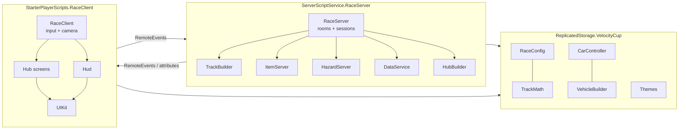

# Architecture

Back to [[Home]] · Setup: [[Project Setup]]

## Scripts at a glance
| Script | Side | Job | Note |
|---|---|---|---|
| `RaceConfig` | shared | all vehicles, tracks, items, shop items, prices, tuning numbers | [[Tuning Cheatsheet]] |
| `TrackMath` | shared | spline → evenly spaced centre line, routes, "where am I on the track" | [[Tracks]] |
| `CarController` | shared | arcade hover physics + AI driver | [[Driving Physics]] |
| `VehicleBuilder` | shared | builds every vehicle from parts, skins, trails | [[Add a Vehicle]] |
| `Themes` | shared | sky/lighting per map | |
| `RaceServer` | server | remotes, waiting rooms, race sessions, lap counting, results | [[Race Flow]] |
| `TrackBuilder` | server | builds a whole circuit from parts | [[Tracks]] |
| `ItemServer` | server | item boxes, item odds, projectiles | [[Items]] |
| `HazardServer` | server | Lagoon Harbor water cannons | |
| `DataService` | server | profiles, shop, daily spin, leaderboards | [[Data and Saving]] |
| `HubBuilder` | server | the server-room hub | |
| `RaceClient` | client | reads input, drives your car, chase camera | [[Driving Physics]] |
| `Hub`, `Hud`, `UIKit` | client | all screens | [[UI]] |

## How server and clients talk
- **Remotes** (folder `ReplicatedStorage.VCRemotes`): `ChooseCar`, `StartSolo`, `CreateRoom`, `JoinRoom`, `LeaveRoom`, `RoomReady`, `RoomSetTrack`, `RoomSetBots`, `RoomStart`, `UseItem`, `Effect` (server → client toasts, boosts, stuns, pushes), and RemoteFunctions `Shop`, `GetLeaderboard`, `DailySpin`.
- **Attributes** carry state: on the Player (`Session`, `Room`, `Car`, `Coins`, `Skin`, `Trail`, `Owned`, `SpinReady`…), on each session folder in `ReplicatedStorage.VCSessions` (`Phase`, `Countdown`, `StartTime`, `Results`…) and on each car model (`Place`, `Lap`, `Item`, `Finished`…).
- Every client request is validated on the server — see [[Anti-Cheat]].

## Who simulates what
- Your own car: **your device** (network ownership is handed to you at the green light) — smooth, lag-free driving.
- Bots, items, hazards, lap counting, results: **server**.
- Several races run at once, each on its own copy of the track 10,000 studs apart ("track slots"); the hub floats at Y = 4000.
