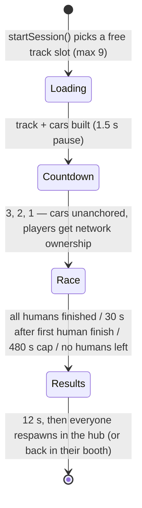

# Race Flow

Back to [[Home]] · Code: `src/server/RaceServer/init.server.luau`

## From the hub to the grid
- **Race bots** (red arch) → pick a map → `StartSolo` → a session starts at once: you + 7 bots.
- **Race players** (blue arch) → `CreateRoom` (pick a map) or `JoinRoom`. Up to `MAX_ROOMS` = 4 rooms of `ROOM_SIZE` = 8. Everyone waits in a glass booth, presses **Ready**, then the host presses **Start**. Needs 2 players, or the host turns on *fill with bots*.

## A session

- Phase lives in the session folder's `Phase` attribute; clients react to it ([[UI]]).
- Each session gets its own track copy at `slotOffset(slot)` (3×3 grid, 10,000 studs apart), its own [[Items]] instance and its own cars folder in `workspace.VCCars`.

## Lap counting (server)
- Every Heartbeat each racer is located on the track with `TrackMath.locateAll` (main line or a shortcut mapped back onto the main line).
- `r.total` is progress in track samples (1600 per lap). The grid sits just behind the line, so lap 1 starts when you first cross it.
- For players, progress can only grow as fast as their vehicle could possibly drive — see [[Anti-Cheat]].
- Lap times feed the personal-best / leaderboard code in [[Data and Saving]].

## Results & coins
- Unfinished racers get a *projected* time (marked `*`).
- Coins: `PLACE_COINS[place]` + `HIT_COINS` per item hit. **Place coins need at least one completed lap** (no AFK farming).

## Edge cases handled
- A player whose character is dead at the start, or who can't be seated, is sent back to the hub instead of being stuck in a race they're not in.
- Leaving mid-race removes your car; the race carries on for everyone else.
- A race that errors is logged with `warn` and cleaned up by `endSession`.

Related: [[Driving Physics]] · [[Tracks]] · [[Architecture]]
